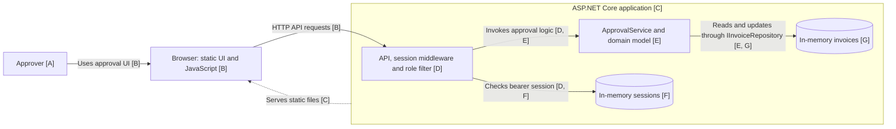
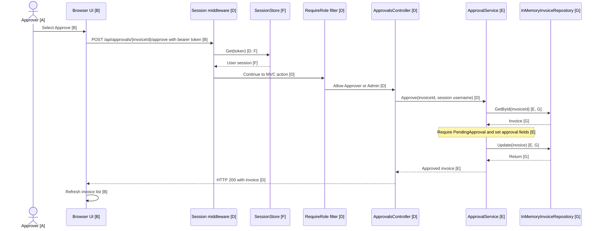
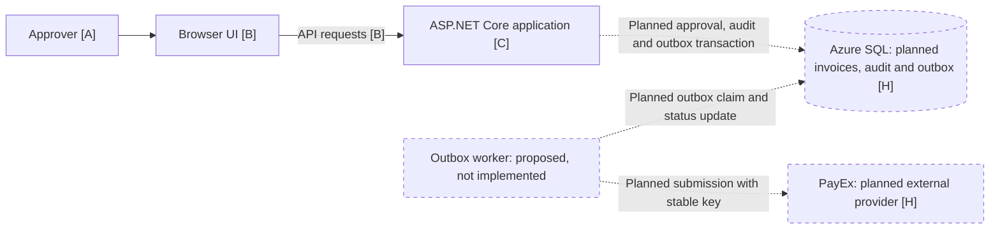

# Invoice Approval architecture

## As-built container view

This view shows runtime boundaries, not separate deployable services. The
controller, domain service and repositories run within the same application.



## As-built approval sequence

The sequence starts with a signed-in user and shows the successful approval
path. It does not imply a database write or payment submission.



Other paths: missing or invalid sessions receive 401; disallowed roles receive
403; missing invoices become 404; non-pending invoices become 409. See [D]
and [E].

## Provisional target container view

Dashed boxes and arrows are **planned, not implemented**. This is a conceptual
view of the proposed outbox decision in `payex-decision.md`, subject to
confirmation of PayEx's contract and business-owner review. The audit
implementation remains undecided. The chosen design does not include Service
Bus. SQL and PayEx are described in [H].



## Citations

Paths are relative to the repository root.

| ID | Evidence |
|---|---|
| A | Role and approval action: `backend/src/InvoiceApp.Api/Controllers/ApprovalsController.cs`, class attributes and `Approve`. The person operating the UI is an actor, not a software container. |
| B | `backend/src/InvoiceApp.Api/wwwroot/index.html`; `wwwroot/app.js`, `api`, `renderPending`, and `decide`. |
| C | `backend/src/InvoiceApp.Api/Program.cs`, service registrations, middleware, static files and controller mapping; `InvoiceApp.Api.csproj`, project reference. |
| D | `backend/src/InvoiceApp.Api/Auth/SessionAuthMiddleware.cs`, `InvokeAsync`; `Auth/RequireRoleAttribute.cs`, `OnActionExecuting`; `Controllers/ApprovalsController.cs`, `Approve`; `Controllers/ApiControllerBase.cs`, `Handle`. |
| E | `backend/src/InvoiceApp.Domain/ApprovalService.cs`, `Approve`, `Find`, and `EnsurePending`; `IInvoiceRepository.cs`; `Invoice.cs`. |
| F | `backend/src/InvoiceApp.Api/Auth/SessionStore.cs`, `Create` and `Get`; `Program.cs`, singleton registration. |
| G | `backend/src/InvoiceApp.Api/InMemoryInvoiceRepository.cs`, `GetById` and `Update`; `Program.cs`, singleton repository registration. |
| H | Assignment PDF, page 1, scenario and fact table; `ops/README.md`, note on the planned scenario. These describe the target, not the current implementation. |

## Inferences and limits

- The user operates the browser UI; the repository establishes the UI and
  approval action but does not document actual users or their deployment.
- The target shows a proposed outbox worker, not an implemented service or a
  guarantee of delivery. The chosen design does not include Service Bus.
- The target audit store is a proposed way to meet the seven-year requirement,
  not evidence that an audit design or retention mechanism exists.
- The sequence begins after sign-in and omits the separate login exchange.
- The Mermaid source was drafted from code inspection and rendered with the
  Mermaid MCP tool. Rendering exposed a syntax error in the original sequence
  note; it was corrected before the final rendering.

## Architecture test

`backend/tests/InvoiceApp.Tests/ArchitectureTests.cs` checks that the compiled
domain assembly has no **direct assembly references** to the API assembly or
ASP.NET Core assemblies. It does not claim to detect every possible transitive
or dynamically loaded dependency.

From the repository root, run:

```powershell
dotnet test backend\InvoiceApp.sln --filter FullyQualifiedName~ArchitectureTests
```

The existing GitHub Actions workflow runs the solution tests on pull requests
targeting `main`; use it when the .NET SDK is unavailable locally.

### Recorded run

On 2026-11-01, the test ran in WSL2 Debian using .NET SDK 8.0.427:
**1 passed, 0 failed, 0 skipped**. WSL did not have ICU installed, so this run
used invariant globalization; the SDK emitted locale warnings. The rule under
test checks assembly references and does not depend on culture.

From PowerShell at the repository root, the equivalent command is:

```powershell
wsl --cd (Join-Path (Get-Location) 'backend') --exec sh -c 'DOTNET_SYSTEM_GLOBALIZATION_INVARIANT=1 "$HOME/.dotnet/dotnet" test InvoiceApp.sln --filter FullyQualifiedName~ArchitectureTests --nologo'
```
